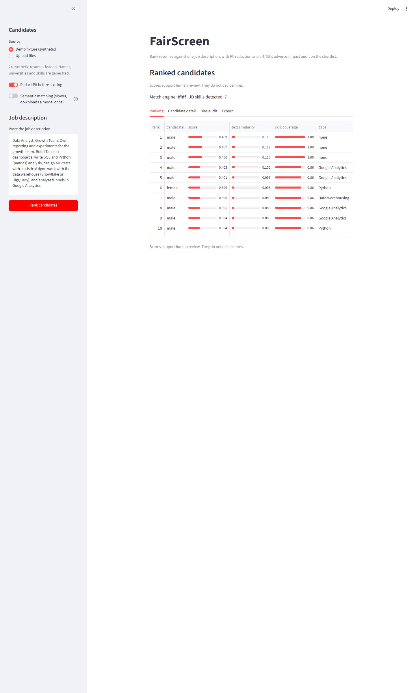
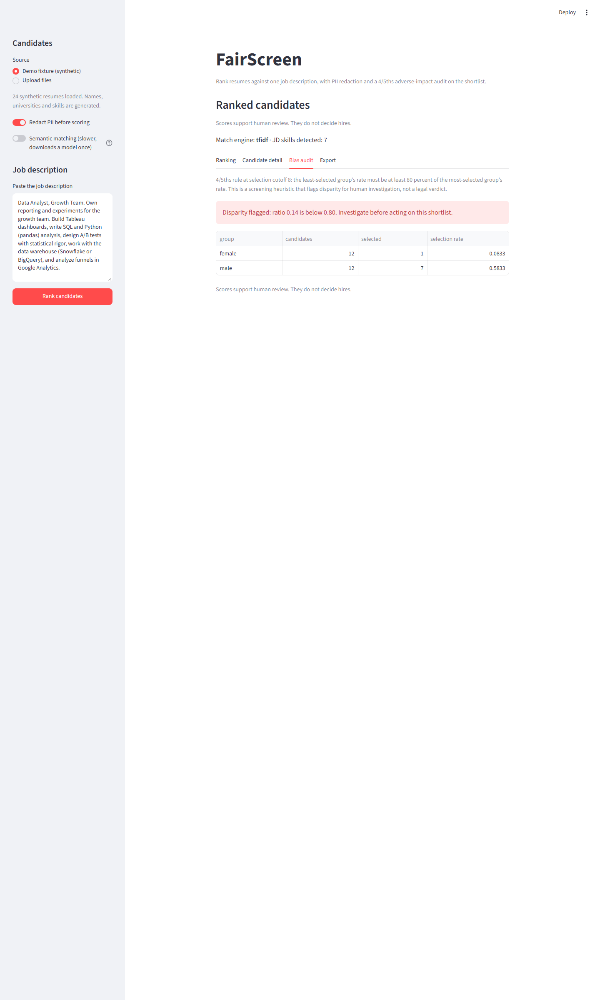

# FairScreen

   

Resume screener for a single job description: rank candidates by match score,
show the skill gaps behind every score, redact identifying details on request,
and run a 4/5ths-rule adverse-impact audit on the resulting shortlist. The
audit measures the ranking you just produced and flags disparity for
investigation.

## What it looks like

**Ranking with visible score components:**



**Bias audit** (the synthetic fixture plants a disparity so the audit has
something real to catch; the banner shows the arithmetic):



## Features

| Capability | What you get |
|---|---|
| Hybrid matching | TF-IDF cosine (offline default) + optional sentence-transformer embeddings; score = 0.6 text + 0.4 skill coverage, components always visible |
| Skills lexicon | ~29 tech skills with word-boundary alias matching; data, not a model, so recruiters can extend it |
| Gap analysis | Per candidate: which JD skills are missing, listed in the table and the detail view |
| PII redaction | Strips emails, phones, URLs and the name line before scoring; ALL-CAPS headings survive |
| Proxy flags | Flags graduation years, gendered pronouns and street addresses found in text (informational, never penalties) |
| Adverse-impact audit | Selection rates per group at a configurable cutoff, 4/5ths rule flag, arithmetic shown |
| Export | Shortlist CSV with rank, scores, components, gaps |

## Measured results

On the shipped synthetic fixture (24 candidates, 12 per group, planted skill gap):

| Group | Candidates | Selected (top 8) | Selection rate |
|---|---|---|---|
| female | 12 | 1 | 0.083 |
| male | 12 | 7 | 0.583 |

Disparity ratio 0.14 < 0.80, so the audit flags it, exactly as designed.

## Quick start

```bash
pip install -r requirements.txt

# 1. Generate the synthetic candidate fixture (24 resumes + ground-truth metadata)
python sample_data/generate.py

# 2. Run the screener
streamlit run fairscreen/app.py
```

The demo fixture loads from the sidebar. For real screening: upload PDF, DOCX
or TXT resumes, optionally attach a group-metadata CSV, paste the job
description, and press Rank candidates.

Optional better matching: set `FAIRSCREEN_EMBEDDINGS=on` (first use downloads
a ~90 MB local embedding model, then runs offline).

## Honesty notes

- The fixture is synthetic: names, universities and skill sets are generated, and each row carries its group label so the audit has ground truth. Real resumes have no reliable group labels; the audit on uploads only reports what you attach.
- Match scores rank candidates for human review. They do not decide hires, and the UI says so on every screen.
- The 4/5ths rule is a screening heuristic from US employment law practice, not a verdict. It flags disparity for human investigation.

## Tech stack

| Layer | Choice |
|---|---|
| Parsing | PyMuPDF (page-aware PDF) + python-docx |
| Lexical match | sklearn TfidfVectorizer + cosine similarity |
| Semantic match | sentence-transformers all-MiniLM-L6-v2 (optional, env-gated) |
| Audit | pandas + the 4/5ths rule, unit-tested arithmetic |
| App | Streamlit |

## Project structure

```
fairscreen/
├── config.py     # env parsing + cutoff clamp
├── parsing.py    # pdf/docx/txt extraction
├── matching.py   # skills lexicon, TF-IDF + optional embeddings, gaps
├── bias.py       # PII redaction, proxy flags, four-fifths audit
└── app.py        # Streamlit screener
sample_data/generate.py   # synthetic fixture with ground-truth metadata
tests/           # 8 unit tests + 2 AppTest suites (rank flow, toggle invalidation)
docs/            # prd, trd, architecture, design, schema, implementation, rules, todo
```
